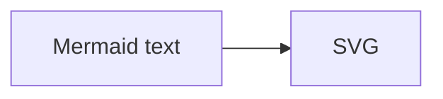

# Pele as switchable Mermaid renderer — Implementation Plan

> **For agentic workers:** REQUIRED SUB-SKILL: Use superpowers:subagent-driven-development (recommended) or superpowers:executing-plans to implement this plan task-by-task. Steps use checkbox (`- [ ]`) syntax for tracking.

**Goal:** Render ```` ```mermaid ```` fences with [pele](https://pele.run) (Obsidian's Mermaid renderer, 230 kB gzip, sync, CSS-variable theming) instead of mermaid.js, behind a `config.toml` switch that keeps mermaid.js one line away.

**Architecture:** The markdown hook keeps emitting `<div class="mermaid-container" data-expandable><pre class="mermaid">…</pre></div>`, so content, lightbox and tests are renderer-agnostic. `head.html` emits exactly one lazy ESM loader (mermaid *or* pele) chosen by `.Site.Params.mermaidRenderer`; both expose the same `window.initMermaid` hook the SPA `render()` calls. Pele colours come from `--pele-*` CSS variables (Kanagawa), so the dark/light toggle needs no re-render. The lightbox re-mounts a pele diagram in its clone so it lays out at overlay width.

**Tech Stack:** Hugo templates, SCSS (auto-bundled from `assets/styles/[!_]*.scss`), vanilla ESM, pele `@1` from jsDelivr, Rust integration test (`utils/obsidian-quartz/tests/hugo_render.rs`) that builds fixtures with the real layouts.

**Spec:** the design agreed in chat on 2026-10-24 (summarised here; no separate spec file — a "small change" by the brainstorming sizing).

## Spec (as agreed)

- `config.toml` `[params]`: `mermaidRenderer = "pele"` — values `"mermaid"` | `"pele"`; absent → `"mermaid"` (zero behaviour change for upstream/blog).
- When pele is chosen **only** the pele script is emitted; when mermaid, the existing mermaid block verbatim.
- Stays lazy: library imported only when `pre.mermaid` exists in the DOM (first load + SPA navigation), so Lighthouse on diagram-free pages is unchanged; on diagram pages pele is ~7× smaller than mermaid.
- The new (pele) look is intended. Colours: Kanagawa, matched to the site's light and dark themes (`[saved-theme="dark"]`); user now uses pele in Obsidian too, so the diagrams match the vault.
- Zoom/expand: the existing lightbox expand button on `.mermaid-container` keeps working the same way as with mermaid.
- Blog (`sspaeti-hugo-blog`) untouched, stays on mermaid@11.
- My calls: default stays `mermaid` in code (config.toml sets `pele`); pele `zoom: false` on the page (lightbox is the zoom); pele `autoDirection` left at its default (LR→TB under 640 px).

## Global Constraints

- Private vault is read-only; only this repo changes. No content edits needed (all 23 diagram notes use syntax pele supports: graph/flowchart, gantt, sequence, mindmap, xychart-beta, `<br/>` labels, `%%{init}%%` directives).
- CDN script URLs: jsDelivr only, `pele@1` semver range (same policy as `mermaid@11`).
- New SCSS files must be pure ASCII (Dart Sass emits a BOM on non-ASCII and the first rule of the bundle silently breaks).
- `make test` must stay green; every rendering change gets a fixture + assertion in `hugo_render.rs`.
- `CLAUDE.md` Mermaid bullet, `CHANGELOG.md` entry and `config.toml` comment document the switch.

## Review Focus

1. Page with **no** diagram: neither CDN import must fire (pinned by Task 1 test: loader script present but `import()` only inside the DOM-guarded function; manual network check in Task 5).
2. SPA navigation to a diagram page: `window.initMermaid` must exist under pele too (Task 2 asserts the hook name is in the HTML).
3. Dark/light toggle: pele SVG recolours without re-render; `--pele-*` must be defined under `[saved-theme="dark"]` (Task 3 asserts both selectors in the compiled CSS).
4. Lightbox clone: a pele diagram must render at overlay width, not stay at the inline width (Task 4: `__rerenderDiagrams` re-mounts the clone).
5. `mermaidRenderer` absent or misspelt → mermaid block (Task 1 test builds with the renderer overridden to `mermaid` and asserts the mermaid URL).

---

### Task 1: Config switch + pele loader in head.html

**Files:**
- Modify: `config.toml` (`[params]`, after `rssFullContent`)
- Modify: `layouts/partials/head.html:496-611` (the `<!-- Mermaid: lazy-loaded … -->` module script)
- Create: `utils/obsidian-quartz/tests/hugo-render/content/diagram.md` (fixture)
- Create: `utils/obsidian-quartz/tests/hugo-render/config-mermaid.toml` (test-only override `[params] mermaidRenderer = "mermaid"`)
- Test: `utils/obsidian-quartz/tests/hugo_render.rs`

**Interfaces:**
- Produces: `window.initMermaid()` (both engines), `window.__rerenderDiagrams(root: Element)` (pele only; re-mounts every `pre.mermaid` under `root`), `data-original-content` attribute on each `pre.mermaid` holding the source text.
- Produces: `build_with(extra_config: &[&str]) -> PathBuf` test helper; `build()` becomes `build_with(&[])`.

- [ ] **Step 1: Write the failing tests**

Fixture `diagram.md`:
```markdown
---
title: "Diagram"
---

```

In `hugo_render.rs`, refactor `build()` into `build_with(extra: &[&str])` that appends each path to the `--config` list, then add:

```rust
#[test]
fn diagram_renderer_pele_by_config() {
    let out = build();                      // production config.toml => pele
    let page = page(&out, "diagram");
    assert!(page.contains(r#"<pre class="mermaid">"#), "fence still renders the renderer-agnostic pre.mermaid");
    assert!(page.contains("cdn.jsdelivr.net/npm/pele@1/dist/pele.js"), "pele ESM loader emitted");
    assert!(!page.contains("mermaid.esm.min.mjs"), "mermaid.js loader not emitted when pele is chosen");
    assert!(page.contains("window.initMermaid"), "SPA render() hook exists under pele");
    assert!(page.contains("window.__rerenderDiagrams"), "lightbox re-mount hook exists under pele");
    let _ = std::fs::remove_dir_all(&out);
}

#[test]
fn diagram_renderer_mermaid_fallback() {
    let out = build_with(&["utils/obsidian-quartz/tests/hugo-render/config-mermaid.toml"]);
    let page = page(&out, "diagram");
    assert!(page.contains("mermaid@11/dist/mermaid.esm.min.mjs"), "mermaid.js loader emitted when mermaidRenderer = mermaid");
    assert!(!page.contains("npm/pele@1"), "pele not emitted when mermaidRenderer = mermaid");
    let _ = std::fs::remove_dir_all(&out);
}
```

- [ ] **Step 2: Run to verify they fail**

Run: `cd utils/obsidian-quartz && cargo test --test hugo_render diagram_renderer`
Expected: both FAIL (`pele.js` string absent).

- [ ] **Step 3: Add the config key**

`config.toml` `[params]`:
```toml
  # Mermaid fence renderer (layouts/partials/head.html): "pele" = https://pele.run (Obsidian's
  # renderer, 230 kB, own layout, Kanagawa colours via --pele-* in assets/styles/pele.scss),
  # "mermaid" = mermaid.js@11 as before. Only the chosen engine's loader is emitted; both are
  # lazy (imported only on pages with a diagram). The blog stays on mermaid.
  mermaidRenderer = "pele"
```

- [ ] **Step 4: Wrap the loader in head.html**

Replace the single mermaid `<script type="module">` with:
```
{{ $renderer := .Site.Params.mermaidRenderer | default "mermaid" }}
{{ if eq $renderer "pele" }}
  <!-- Pele: lazy-loaded only when diagrams are detected (config.toml mermaidRenderer) -->
  <script type="module"> …pele block… </script>
{{ else }}
  …existing mermaid block, byte-identical…
{{ end }}
```
Pele block (module scope): `let peleLib = null;` `async function loadPele()` → `import('https://cdn.jsdelivr.net/npm/pele@1/dist/pele.js')`; `async function renderDiagrams(root = document)` → selects `pre.mermaid:not(.mermaid-processed)` under `root`, returns early when none, awaits `loadPele()`, then per element: skip if processed meanwhile; `source = el.getAttribute('data-original-content') || el.textContent.trim()`; set the attribute; add `mermaid-processed`; `el.textContent = ''`; `mount(el, source, { zoom: false, onError: e => console.error('Pele render error:', e) })`. `window.initMermaid = () => renderDiagrams();` `window.__rerenderDiagrams = root => { root.querySelectorAll('pre.mermaid.mermaid-processed').forEach(el => { el.classList.remove('mermaid-processed'); el.textContent = ''; }); return renderDiagrams(root); };` Same `DOMContentLoaded` listener and the same MutationObserver as the mermaid block (copy it). No theme-toggle listeners (CSS variables recolour live).

- [ ] **Step 5: Run tests**

Run: `cd utils/obsidian-quartz && cargo test --test hugo_render`
Expected: all PASS (including the pre-existing two).

- [ ] **Step 6: Commit**

```bash
git add config.toml layouts/partials/head.html utils/obsidian-quartz/tests/
git commit -m "feat: pele as switchable mermaid renderer (config mermaidRenderer)"
```

### Task 2: Kanagawa theme for pele (light + dark)

**Files:**
- Create: `assets/styles/pele.scss` (auto-bundled: `resources.Match "styles/[!_]*.scss"`)
- Test: `utils/obsidian-quartz/tests/hugo_render.rs`

**Interfaces:**
- Consumes: site tokens `--font-body`, `--font-mono`, `[saved-theme="dark"]` attribute on `<html>`.
- Produces: `--pele-*` variables on `:root` and `[saved-theme="dark"]`.

- [ ] **Step 1: Write the failing test** (append to `diagram_renderer_pele_by_config`)

```rust
let css_href = Regex::new(r#"href="([^"]*styles\.[a-f0-9]+\.min\.css)""#).unwrap()
    .captures(&page).expect("bundled stylesheet link")[1].to_string();
let css = std::fs::read_to_string(out.join(css_href.trim_start_matches("/brain/"))).unwrap();
assert!(css.contains("--pele-fg:"), "pele variables bundled");
assert!(is_match(&css, r#"\[saved-theme=dark\][^{]*\{[^}]*--pele-bg:#1f1f28"#), "dark Kanagawa surface for pele");
```
(adjust the selector regex to what Dart Sass emits — quotes are stripped in compressed output.)

- [ ] **Step 2: Run, expect FAIL** (`--pele-fg` absent).

- [ ] **Step 3: Write `assets/styles/pele.scss`** — ASCII only. Values:

```
:root {
  --pele-font: var(--font-body); --pele-font-mono: var(--font-mono); --pele-radius: 4px;
  // light: site card bg + Kanagawa lotus accents
  --pele-bg: #faf8f8; --pele-fg: #141021; --pele-muted: #727070; --pele-line: #545464;
  --pele-surface: #f0f0f0; --pele-surface-alt: #e6e3de; --pele-border: #c9c6c0;
  --pele-accent: #3150aa; --pele-critical: #c84053;
  --pele-series-1: #c84053; -2: #cc6d00; -3: #77713f; -4: #6f894e;
  --pele-series-5: #597b75; -6: #4d699b; -7: #624c83; -8: #b35b79;
}
[saved-theme="dark"] {
  // Kanagawa wave: sumiInk1 card, fujiWhite text, oldWhite lines
  --pele-bg: #1f1f28; --pele-fg: #dcd7ba; --pele-muted: #c8c093; --pele-line: #c8c093;
  --pele-surface: #2a2a37; --pele-surface-alt: #363646; --pele-border: #54546d;
  --pele-accent: #7e9cd8; --pele-critical: #c34043;
  --pele-series-1: #ff5d62; -2: #ffa066; -3: #e6c384; -4: #98bb6c;
  --pele-series-5: #7aa89f; -6: #7e9cd8; -7: #957fb8; -8: #d27e99;
}
pre.mermaid:has(svg.pele) { white-space: normal; font-family: var(--font-body); background: transparent; padding: 0; }
```
Write each `--pele-series-N` out in full (the `-N:` above is shorthand for the plan only).

- [ ] **Step 4: Run tests, expect PASS.**

- [ ] **Step 5: Commit** `git commit -m "style: Kanagawa light/dark theme for pele diagrams"`

### Task 3: Lightbox re-mounts pele diagrams at overlay width

**Files:**
- Modify: `assets/js/lightbox.js:96-102` (the clone branch)

**Interfaces:**
- Consumes: `window.__rerenderDiagrams(root)` from Task 1 (undefined under mermaid → no-op, clone stays the static SVG as today).

- [ ] **Step 1: Change the clone branch**: after `body.appendChild(clone); overlay.classList.add('lightbox-visible');` add
```js
// pele lays out for the container width; re-mount so the overlay gets a full-width diagram
if (window.__rerenderDiagrams) window.__rerenderDiagrams(clone);
```
Update the file header comment ("mermaid diagrams" → "diagrams (mermaid.js or pele, see head.html)").

- [ ] **Step 2: Manual check** (no unit harness for browser JS): `make run`, open `/brain/mermaid/`, click expand → overlay shows the diagram re-laid-out wider than inline; Esc closes; the inline one is untouched. Toggle dark/light with the overlay closed → inline diagram recolours instantly, no flash.

- [ ] **Step 3: Commit** `git commit -m "fix: lightbox re-mounts pele diagrams at overlay width"`

### Task 4: Docs

**Files:**
- Modify: `CLAUDE.md:16` (Mermaid bullet)
- Modify: `CHANGELOG.md` (new top entry `### 2026-10-24: Pele renders mermaid fences`)

- [ ] **Step 1: CLAUDE.md** — rewrite the bullet: hook unchanged; `head.html` emits one lazy loader chosen by `config.toml` `mermaidRenderer` (`pele` = pele@1 ESM from jsDelivr, themed by `assets/styles/pele.scss` `--pele-*` on `:root`/`[saved-theme="dark"]`, no re-render on theme toggle; `mermaid` = mermaid@11 as before, keep in step with the blog). Both expose `window.initMermaid` for SPA navigation; pele also `window.__rerenderDiagrams(root)` used by `lightbox.js`. Covered by `make test`.
- [ ] **Step 2: CHANGELOG.md** — entry in the existing style: what changed, why (speed/size, same renderer as Obsidian), the switch, the Kanagawa variables, the lightbox re-mount, blog untouched.
- [ ] **Step 3: Commit** `git commit -m "docs: pele renderer switch"`

### Task 5: Verify in browser + Lighthouse

- [ ] **Step 1:** `make run`; visit `/brain/mermaid/` (graph + init directive), `/brain/pollmd/` (`<br/>` labels, subgraphs), a gantt note (`grep -l '^gantt' content/*.md`), the xychart note, `/brain/mindmap`-style note. All render, console has no `Pele render error`.
- [ ] **Step 2:** Network tab on a diagram-free note: no `pele.js` request. On a diagram note: one `pele.js` request, no `mermaid`.
- [ ] **Step 3:** `make lighthouse P=mermaid/` — performance ≥ previous run (expect ≥ 95 mobile, 100 desktop). Record the numbers in the final report.
- [ ] **Step 4:** `make test` green. Commit nothing (verification only).
